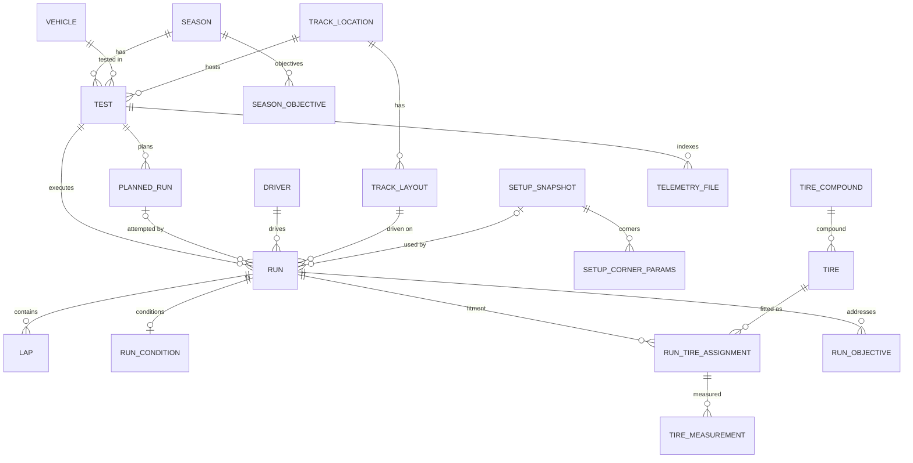

# Race UP Test Data Manager

A traceable engineering history of Formula Student testing: season → test → run → lap, with
planned versus actual execution, immutable setups, tyres and measurements, mileage, and
multi-filter historical search. It replaces scattered spreadsheets with one consistent database.

> **Assignment context.** This is Task 2 of the Race UP Electric Software 2026/27 selection.
> The organisers' original brief is preserved verbatim in
> **[docs/assignment-brief.md](docs/assignment-brief.md)**.
>
> **Status.** An assignment-ready, interview-ready **runnable vertical slice**: a FastAPI
> backend (52 API paths, 508 tests), a React frontend (24 tests), Docker Compose and CI. It is
> not hardened for production: there is no authentication, and it runs on SQLite.

**Documentation:**
- [architecture](docs/architecture.md)
- [data model and ER diagrams](docs/data-model.md)
- [import strategy](docs/import-strategy.md)
- [assumptions](docs/assumptions.md)
- [thought process](docs/ToughtProcess.md)
- [frontend](frontend/README.md)

---

## Quick start (Docker)

You need Docker with Compose v2.

```bash
SEED_DEMO_DATA=true docker compose up --build        # bash
$env:SEED_DEMO_DATA="true"; docker compose up --build  # PowerShell
```

| URL | What |
|---|---|
| http://localhost:8080 | Frontend dashboard |
| http://localhost:8080/docs | OpenAPI documentation, proxied by the frontend's Nginx |
| http://localhost:8000/docs | OpenAPI directly from the backend |

- The backend applies migrations every time it starts.
- `SEED_DEMO_DATA=true` loads the synthetic demo dataset. Seeding is idempotent, and it is
  never done by default.
- Data lives in the named volume `race-up-tdm_tdm-data`. `docker compose down` keeps it, and
  `docker compose down -v` deletes it.

## Implemented scope

| Area | What exists |
|---|---|
| Hierarchy | Seasons, vehicles (generations), drivers, track locations and layouts with **verified lengths**, tests, actual runs, laps |
| Planned vs actual | Planned runs, kept unchanged once created. **Cancel**, **replace** (atomic) and **complete** commands. A plan can have **0..N actual attempts**. Unexpected runs have no plan. Per-run comparison and a test-level summary. |
| Setup story | **Append-only** setup snapshots (vehicle and FL/FR/RL/RR corner values). *Derive* records a change with its reason. A computed **diff**. An ORM guard prevents updates. |
| Conditions | Ambient and asphalt temperature, source, weather, track state; recorded once per run |
| Laps | Single and **atomic bulk** ingestion. Timing validity is separate from physical completion. Untimed laps are allowed. Penalties. An implied-speed plausibility check. |
| Derived values | Effective time, fastest eligible lap and **mileage** (run, test, season, vehicle and driver lifetime). All are computed when requested, never stored. |
| Tyres | Compounds, sets, physical tyres with globally unique serials, per-corner fitment, and pre/post-run pressure and three-zone temperature. Observed alignment is kept separate from the intended setup. |
| Historical search | `GET /api/v1/runs` with 16 filters combined with AND, including **tyre compound** and **asphalt range**. Pagination is deterministic, and each page costs four SQL statements. |
| Analytics | Fastest-lap ranking per layout or activity, and test plan versus actual |
| Traceability | Season objectives linked to tests and runs, with derived progress. A metadata-only telemetry and log file index. |
| Data | Four Alembic migrations, a deterministic synthetic **seed**, and a **CSV importer** (dry run by default, whole file atomic) |
| Frontend | Dashboard, run history browser, test, run and setup views, and a create-test form |

**Deferred** (see [docs/data-model.md §7](docs/data-model.md)):
- test-day stations; sector times;
- setup-performance statistics; partial-lap distance;
- correction workflows for create-once records;
- authentication;
- binary file upload;
- frontend logging of runs and laps (use the API or the CSV importer).

## Architecture

```
frontend (React + TS, Nginx) ──/api──▶ backend (FastAPI)
  routers (HTTP) → services (rules; flush, never commit) → models (SQLAlchemy 2)
  queries (read compositions)  schemas (Pydantic 2, separate from the ORM)
  one transaction per request · central error mapping · SQLite + Alembic
```



All 22 tables with their columns are in [docs/data-model.md](docs/data-model.md); a test checks
those diagrams against the ORM.

**Stack:**
- Python 3.12 (verified in Docker), FastAPI, SQLAlchemy 2, Pydantic 2, Alembic, SQLite, pytest, Ruff
- React 19, TypeScript 7 (strict), Vite 8, Tailwind CSS 4, React Router, Vitest
- Nginx, Docker Compose, GitHub Actions

```
backend/   app/{models,schemas,services,queries,routers}  alembic/  scripts/  tests/  sample-data/
frontend/  src/{api,components,pages,types,utils,test}  nginx.conf
docs/      architecture, data model, import strategy, assumptions, thought process, brief
```

## Engineering units

Units are part of the field names, and values are stored in those units:

| Suffix | Unit |
|---|---|
| `_ms` | integer milliseconds |
| `_m` | metres (`NUMERIC`, mm resolution) |
| `_c` | °C |
| `_kpa` | gauge kPa |
| `_kw`, `_kwh` | kW, kWh |
| `_rpm` | rpm |
| `_deg` | degrees |
| `_n_per_mm` | N/mm |

Timestamps are UTC ISO 8601, and decimals are serialised as strings so they stay exact. Details
are in [data-model.md §2](docs/data-model.md).

## Local development

You need Python 3.12 or 3.13, Node 24 and npm 11.

**Backend** (run from `backend/`):

```bash
python -m venv .venv
source .venv/bin/activate                      # PowerShell: .venv\Scripts\Activate.ps1
python -m pip install -c constraints.txt -e ".[dev]"
alembic upgrade head                           # creates backend/var/tdm.sqlite3
python -m scripts.seed                         # optional synthetic demo data
uvicorn app.main:create_app --factory --reload --port 8000
```

**Frontend** (run from `frontend/`; it proxies `/api` to port 8000):

```bash
npm ci
npm run dev                                    # http://localhost:5173
```

**Environment variables:**

| Variable | Default | Used by |
|---|---|---|
| `DATABASE_URL` | `sqlite:///backend/var/tdm.sqlite3` (locally); `sqlite:////data/tdm.sqlite3` (Docker) | backend, Alembic, scripts |
| `SEED_DEMO_DATA` | `false` | backend container entrypoint |
| `TDM_BACKEND_URL` | `http://127.0.0.1:8000` | Vite dev proxy target |
| `VITE_API_BASE_URL` | `/api/v1` | frontend build |

**Data commands** (run from `backend/`):

```bash
alembic upgrade head        # also: alembic current, alembic check (no-drift check)
python -m scripts.seed      # repeat-safe: a second run writes nothing
python -m scripts.import_csv sample-data/historical_runs.csv            # dry run, writes nothing
python -m scripts.import_csv sample-data/historical_runs.csv --commit   # all rows or none
```

The importer prints a JSON summary with row-level errors. The sample CSV needs the demo
reference data from the seed. The format is described in
[import-strategy.md](docs/import-strategy.md).

**Tests, lint and build:**

| Command | Directory |
|---|---|
| `python -m pytest -q`, `ruff check .`, `ruff format --check .`, `python -m pip check` | `backend/` |
| `npm run typecheck`, `npm test`, `npm run build` | `frontend/` |

The [Makefile](Makefile) wraps these commands (`make acceptance`, `make compose-demo`, …) for
POSIX shells. Make is optional: every target is one of the commands above.

**Dependency lock.**
- Python: `backend/constraints.txt` pins every version that was verified, applied with
  `pip install -c`. `pyproject.toml` keeps the allowed ranges. After a deliberate upgrade,
  regenerate it from a **fresh** virtual environment
  (`pip install -e ".[dev]" && pip freeze --exclude-editable > constraints.txt`), then rerun
  the tests.
- Frontend: `package-lock.json`, installed with `npm ci`.

## API overview

All paths are under `/api/v1`; the full list is in [architecture.md](docs/architecture.md).

| Area | Endpoints |
|---|---|
| Reference data | `seasons`, `vehicles`, `drivers`, `track-locations`, `track-layouts` (POST and GET) |
| Tests and plans | `POST /tests` (optionally with its run plan), `GET /tests/{id}`, `GET /tests/{id}/plan-vs-actual`, `POST /planned-runs/{id}/cancel`, `/replace`, `/complete` |
| Runs | `POST /tests/{id}/runs`, `GET /runs` (**search**), `GET /runs/{id}` with `/conditions`, `/laps`, `/laps/bulk`, `/fastest-lap`, `/mileage`, `/plan-comparison` |
| Setups | `POST /setup-snapshots`, `POST /setup-snapshots/{id}/derive`, `GET /setup-snapshots/{id}/diff` |
| Tyres | `tire-compounds`, `tire-sets`, `tires`, and per run `/tire-assignments`, `/tire-measurements`, `/alignment-measurements` |
| Mileage and analytics | `/{runs,tests,seasons,vehicles,drivers}/{id}/mileage`, `/analytics/fastest-laps` |
| Traceability | `/seasons/{id}/objectives`, `/tests/{id}/objectives`, `/runs/{id}/objectives`, `/tests/{id}/files` |

Errors always have the form `{"error": {"code", "message", "details": [{"field", "issue"}]}}`:
404 for a missing path resource, 409 for a conflict or state violation, 422 for validation.

**The brief's example query** (with the demo data): "runs of this season by driver X on
compound Y with asphalt between 30 and 40 °C".

```
GET /api/v1/runs?season_id=1&driver_id=1&tire_compound_id=1&asphalt_temperature_min_c=30&asphalt_temperature_max_c=40
```

This returns DEMO-ADA's runs 1, 3 and 4 of the 2025-10-12 test day. Each comes with its
conditions, lap counts, fastest eligible lap and exact distance; for example, run 1 is
1:02.450 and 8 050.000 m.

**Demonstration path in the UI:**
1. Dashboard.
2. **Run history**: filter by season, driver, *SOFT-D* and asphalt 30–40.
3. Open **Run 1**: laps of every kind, fastest lap, mileage, tyres FL to RR, and plan comparison.
4. Open its **test**: cancelled, replaced and repeated plans, and an unexpected run.
5. Open the **setup snapshot** (*E25 autocross rear toe +*) to see its diff.
6. **New test**.

## Design decisions (summary)

The reasoning is in [docs/ToughtProcess.md](docs/ToughtProcess.md).

- **Nothing derivable is stored.** Effective time, best lap, mileage and plan deviations are
  computed from rows, so nothing has to be kept in sync.
- **History is append-only.** There are no PATCH or DELETE endpoints. Planned values are
  never overwritten. Setups change only by derivation. Conditions, fitment and measurements
  are recorded once.
- **The database is the final integrity boundary.** Every constraint is named. Composite
  foreign keys enforce the tyre's compound against its set, and require a fitted tyre before
  a corner can be measured. Cross-row rules are enforced in services.
- **Timing validity and physical completion are independent.** A timing-invalid or untimed
  lap still counts its distance. Penalties change ranking, not distance.
- **One transaction per request.** It commits before the response is sent
  (`Depends(..., scope="function")`), so a failed commit can never look like a 201. A test
  proves this.

## SQLite limitations and PostgreSQL notes

- **SQLite.**
  - NUMERIC is stored with REAL affinity and read back at its declared scale. Sums are done
    in Python `Decimal`, not in SQL.
  - A failed migration can leave partial DDL; back up the file first.
  - One writer at a time.
  - Foreign keys are enabled on every connection, and migrations follow SQLite's documented
    foreign-key procedure.
- **PostgreSQL migration.** Switch `DATABASE_URL`, then:
  - use `timestamptz` (a revision changing `UTCDateTime`'s implementation);
  - NUMERIC becomes exact;
  - drop the batch and pragma handling;
  - consider native ENUM types, a CHECK for "REPLACED requires a reason", and generated
    columns for effective time.

  Details are in [data-model.md §8](docs/data-model.md).

## Known limitations

- No authentication or authorisation.
- Create-once records cannot be corrected.
- The CSV importer accepts only the canonical format.
- Search ordering is fixed and pagination is offset-based.
- There is a single write workflow in the UI.
- Python 3.13 has been verified locally and Python 3.12 in Docker. GitHub Actions has not run
  yet; the workflow is in place.

## CI

[`.github/workflows/ci.yml`](.github/workflows/ci.yml) runs on pushes to `main` and on pull
requests:

| Job | Steps |
|---|---|
| Backend (Python 3.12) | constrained install, `pip check`, migrations from empty plus `alembic check`, Ruff, pytest |
| Frontend (Node 24) | `npm ci`, type check, tests, build |
| Docker | Compose validation, image builds, a seeded smoke test through the Nginx proxy |

The commands were run locally and in matching containers, and the workflow passes
`actionlint`.

## Discussion points

- Why a *planned* run and an *actual* run are separate entities, and how 0..N attempts handle
  retries.
- Typed setup tables versus EAV or JSON, and immutability enforced by an ORM guard rather than
  triggers.
- Why `ABORTED` does not imply "not completed", and why mileage is all-or-nothing per lap.
- How the search avoids N+1 queries and duplicates: to-one joins, EXISTS for tyres, and
  `ROW_NUMBER()` for the fastest lap.
- Defects that the tests and audits caught. See the thought process.
