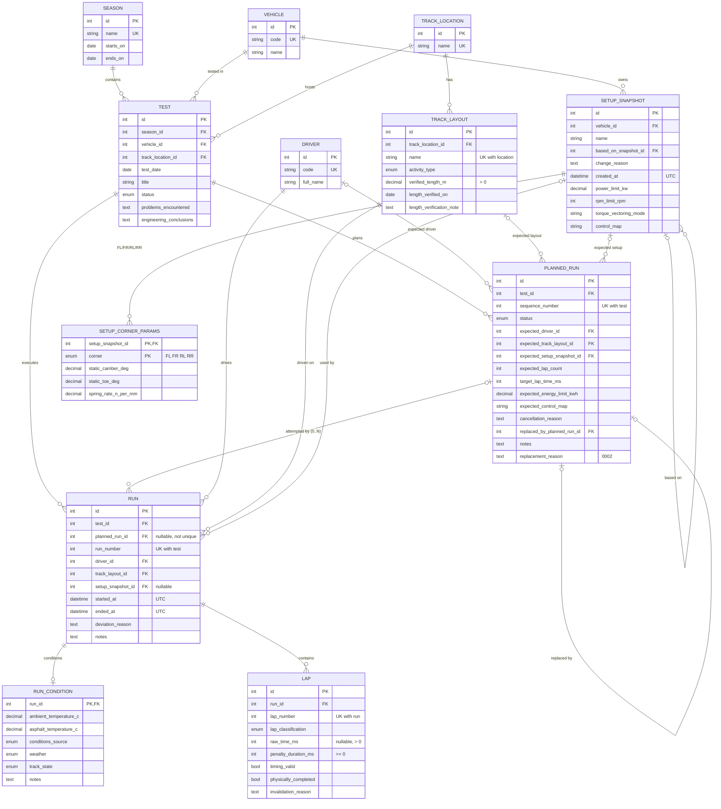
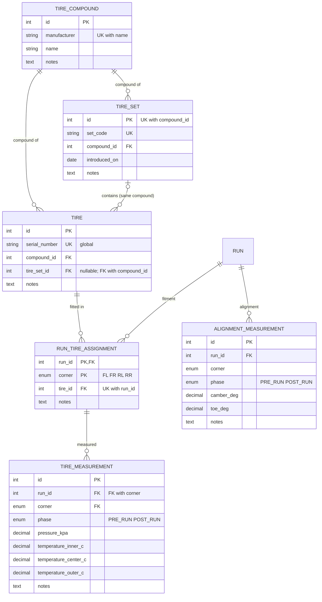

# Data Model

Status: **MVP-Core schema plus tyres implemented** (Alembic revisions `0001` to `0003`).
Source of truth: `backend/app/models/` and `backend/alembic/versions/`;
`backend/tests/test_migrations.py` verifies that migrations and models produce the same schema.

Terminology: **run** always means an actual on-track run of the vehicle (table `run`),
never a software process execution. A **planned run** is the pre-test instruction.

## 1. Implemented schema (MVP-Core)

### 1.1 Tyres and measurements (revision 0003)

Code, tables and API paths use **tire**; one `TIRE` row is one physical tyre.

## 2. Engineering units and numeric precision

Units are carried in column names. Every physical quantity is metric/SI-derived.

| Column suffix | Unit | Storage | Precision |
|---|---|---|---|
| `_ms` | milliseconds | INTEGER | exact |
| `_m` (`verified_length_m`) | metres | NUMERIC(9,3) | 1 mm |
| `_c` | degrees Celsius | NUMERIC(4,1) | 0.1 °C |
| `_kw` | kilowatts | NUMERIC(6,2) | 0.01 kW |
| `_kwh` | kilowatt-hours | NUMERIC(6,3) | 1 Wh |
| `_rpm` | revolutions per minute | INTEGER | 1 rpm |
| `static_camber_deg` | degrees (negative = top inward) | NUMERIC(5,2) | 0.01° |
| `static_toe_deg` | degrees (negative = toe-out) | NUMERIC(5,3) | 0.001° |
| `_n_per_mm` | newtons per millimetre | NUMERIC(7,2) | 0.01 N/mm |
| `*_at` | UTC timestamp | DATETIME (naive UTC) | microseconds |
| `test_date`, `*_on` | local calendar date | DATE | day |
| `pressure_kpa` | kilopascal, gauge | NUMERIC(4,1) | 0.1 kPa |
| `temperature_inner_c` / `_center_c` / `_outer_c` | tyre surface temperature, °C | NUMERIC(4,1) | 0.1 °C |
| `camber_deg` / `toe_deg` (alignment) | degrees | NUMERIC(5,2) / NUMERIC(5,3) | 0.01° / 0.001° |

**SQLite limitation:** SQLite has no exact DECIMAL type. NUMERIC values are stored with
REAL/INTEGER affinity, and SQLAlchemy converts them back to `Decimal` at the declared scale.
At the precisions above, values round-trip deterministically (this is tested), and range
filters behave correctly. PostgreSQL stores them as exact `NUMERIC`.

**Timestamps:** `UTCDateTime` rejects naive datetimes, normalises aware values to UTC,
and returns values with `tzinfo=UTC`. Test days use `DATE`, because a test day is a
calendar concept, not an instant.

## 3. Relationship and modelling decisions

- **Test → TrackLocation; Run → TrackLayout.** This follows the brief ("track location" on
  the test). One test day may use several layouts at the same location, for example skidpad
  in the morning and autocross in the afternoon.
  *Rule:* a run's layout must belong to its test's location. This is a cross-row rule,
  **enforced in the service layer**. Enforcing it in the database would need
  either a denormalised `track_location_id` on `run` plus a composite FK, which duplicates
  data, or a trigger. Phase 2 deliberately uses neither.
- **PlannedRun 1 → 0..N Run.** `run.planned_run_id` is nullable and **not unique**:
  - one plan can have several attempts (aborted attempt, retry);
  - an unexpected run has `planned_run_id = NULL`; no fake plan is created.

  Runs are numbered deterministically by `UNIQUE(test_id, run_number)`.
- **Planned values are never overwritten.** Actual values live on `run` and `lap`.
  Planned-versus-actual comparison is derived by query (`GET /runs/{id}/plan-comparison`).
  `expected_track_layout_id` was added to the planned run, so that the comparison can show a
  layout change.
- **Planned-run status transitions** are explicit service commands: cancel, replace and
  complete (see `docs/architecture.md`). The database enforces only row-local invariants:
  - CANCELLED requires a reason;
  - REPLACED requires a replacement link, and vice versa;
  - a plan cannot replace itself.

  Two further rules are enforced in services: a replacement belongs to the same test, and
  REPLACED requires a `replacement_reason`.
- **`planned_run.replacement_reason` (revision 0002)** records why a plan was replaced. It is
  a dedicated column so that the reason never overwrites either plan's engineering `notes`.
  It was added as a nullable column using SQLite's native ADD COLUMN, so existing rows are
  untouched. A database CHECK ("REPLACED requires a reason") would force a rebuild of
  `planned_run`, which `run` references, so this rule lives in the service layer instead.
- **Nothing derivable is stored.** The following are all computed in queries (Phase 5):
  - completed lap count;
  - effective lap time (`raw_time_ms + penalty_duration_ms`);
  - best lap;
  - mileage.
- **Setup snapshots are append-only.** A change creates a new snapshot with
  `based_on_snapshot_id`, `change_reason` (required by CHECK when derived) and `created_at`.
  One snapshot can be shared by many runs; that sharing is how reusable configurations are
  represented. The API has no update or delete operation. In addition, an ORM `before_flush`
  guard rejects any update or delete of a persisted snapshot or corner row, and any attempt to
  attach a corner to a persisted snapshot. The guard applies to every ORM session (API, seed
  and import). Raw SQL is not guarded, because there are no database triggers by design.
  Diffs are computed from two snapshots on demand and are never stored.
- **Partial corner data is allowed.** A snapshot may hold zero to four corner rows. An
  absent corner is an absent row, reported as `missing_corners`, and is never defaulted.
  A corner row must carry at least one value.
- **Setup storage: typed columns, no EAV or JSON.**
  - Whole-vehicle parameters are typed columns on `setup_snapshot`.
  - Per-corner parameters are rows in `setup_corner_params`, with `PK(setup_snapshot_id, corner)`.

  A separate 1:1 `setup_vehicle_params` table (proposed in Phase 1) was **merged into
  `setup_snapshot`**. It would add a join, and a "snapshot without parameters" state,
  without adding any integrity. Torque-vectoring mode and control map are labels, not
  enums, because the available modes differ between vehicle generations.
- **Unknown values are NULL and never invented.** This covers:
  - `run.setup_snapshot_id` (setup unknown, e.g. imported history);
  - `lap.raw_time_ms` (lap driven but no time recorded);
  - all condition values.

  `run_condition.conditions_source` (MEASURED/ESTIMATED) is required whenever a temperature is present.
- **Delete behaviour:**
  - Owned children cascade: `lap` and `run_condition` with their run, and corner rows with
    their snapshot.
  - Every other FK uses the default (NO ACTION), so historical parents with children
    cannot be deleted. This is tested for `test`.

## 3a. Tyre modelling decisions

**Compound ownership:**
- `tire.compound_id` is always set, so runs can be filtered by compound with one join.
- `tire.tire_set_id` is optional, because single spare tyres exist.
- A tyre in a set always has the set's compound. This is a **database invariant**: `tire`
  has a composite FK `(tire_set_id, compound_id)` to `tire_set(id, compound_id)`, which is
  backed by `UNIQUE(id, compound_id)` on `tire_set`. No trigger is used, and there is only
  one source of truth.
- For a standalone tyre `tire_set_id` is NULL. The composite FK is then not checked (MATCH
  SIMPLE), and `compound_id` is checked by its own FK.
- The service fills in the set's compound automatically, and rejects a contradicting
  `compound_id` with 422 `tire_compound_mismatch`.

**Physical identity:**
- `tire.serial_number` is globally unique (409 `tire_identifier_taken`).
- Referenced tyres cannot be deleted; this is tested.

**Fitment** (`run_tire_assignment`) is recorded on actual runs only, never on planned runs:
- The primary key `(run_id, corner)` allows one tyre per corner.
- `UNIQUE(run_id, tire_id)` stops one tyre from occupying two corners of a run.
- The same tyre may be fitted on many runs: repeated attempts, retries and unexpected runs.
- Fitment is **create-once**, with no update or delete. Corners may be recorded together or
  in several requests. Corrections are deferred to explicit correction records.

**Mixed compounds** within one run can be represented. The run search's `tire_compound_id`
matches a run if **any** fitted tyre uses that compound (see `docs/architecture.md`). Asking
"all four corners on compound X" would need a future, stricter filter.

**Tyre measurements** (`tire_measurement`) record gauge pressure and inner, centre and outer
surface temperature for one corner and phase (PRE_RUN or POST_RUN).
- The composite FK `(run_id, corner)` to `run_tire_assignment` means **a corner without a
  fitted tyre cannot be measured**. The measured tyre is therefore always known, and it is
  returned as `tire_id`.
- `UNIQUE(run_id, corner, phase)`.
- Individual values may be NULL (not measured), but CHECK `has_a_value` requires at least
  one, and CHECK requires pressure to be greater than 0.

**Alignment measurements** (`alignment_measurement`) record observed camber and toe per run,
corner and phase, with `UNIQUE(run_id, corner, phase)` and at least one value.
- They are deliberately separate from `setup_corner_params`: a **setup snapshot is the
  intended static configuration**, while an alignment measurement is **what was measured
  around a run**.
- A measurement never writes to a snapshot (tested), so comparing the two shows drift.

**Plausibility ranges** are application policy in `app/policies.py`, not CHECK constraints.
Each is inclusive:

| Value | Range |
|---|---|
| Pressure | 0 < p ≤ 400.0 kPa |
| Tyre temperature | −30.0 to 150.0 °C |
| Camber | ±10° |
| Toe | ±5° |

## 4. Lap semantics encoded in the schema

| Rule | Where |
|---|---|
| `lap_number > 0`, `UNIQUE(run_id, lap_number)` | DB |
| `raw_time_ms > 0` when present | DB |
| untimed lap (`raw_time_ms IS NULL`) ⇒ `timing_valid = false` | DB |
| `penalty_duration_ms >= 0`, default 0 | DB |
| `timing_valid` ⇔ `invalidation_reason` is NULL; invalid ⇒ non-blank reason | DB |
| classification ∈ {FLYING, IN_LAP, OUT_LAP, ABORTED} | DB |
| a penalised lap stays timing-valid | DB (no rule couples the two) |
| ABORTED vs physically completed | **not a DB rule**; an ABORTED record marked physically completed counts one layout |
| contradictory validity input | service, 422 `invalid_lap_state`; the DB CHECKs are the backstop |
| plausibility (implied average speed per activity type, on raw time) | **application policy** (`app/policies.py`) |
| effective time, fastest-lap eligibility, mileage contribution | derived `hybrid_property`s on `Lap`; never stored |
| no global maximum lap time | deliberate |

Why ABORTED is not a database rule: "aborted" describes the timed attempt. A driver can
abort a push lap and still drive the complete loop back to the pits. Forcing
`physically_completed = false` would therefore lose real distance. Mileage counts exactly the
`physically_completed` laps. An ABORTED record therefore counts one full layout only when it
explicitly says that the loop was completed.

**Binary mileage limitation.** A lap contributes either one full verified layout length or
zero. There is no partial-distance field, so the distance of a lap abandoned mid-loop is
never estimated. A future partial-distance model would add a nullable, verified
`completed_distance_m` with its own source. It is not part of the MVP.

Temperature plausibility ranges are also application-level (`app/policies.py`). They are not
database CHECKs, because they are policy, not physical invariants.

## 5. Constraint naming

All constraints are named by the convention in `app/models/base.py`:
`pk_<table>`, `fk_<table>_<column>_<referred_table>`, `uq_<table>_<columns>`,
`ck_<table>_<name>`, `ix_<table>_<columns>`. This is required for SQLite batch
migrations, and it gives predictable names for IntegrityError translation (Phase 3).
SQLite reports CHECK failures by constraint name and UNIQUE failures by `table.column`.
FK failures carry no name, so services will pre-check referenced rows to return 404s.

## 6. Indexes

SQLite does not index foreign keys automatically. Each index is justified only by an
MVP-Core query. The data volume is small: tens of tests and thousands of laps per season.

| Index | Query supported | Column order / selectivity | Covered elsewhere? | Cost |
|---|---|---|---|---|
| `ix_test_season_id_test_date` | Tests of a season ordered by date; season filter in run search (`test.season_id = ? [AND test_date BETWEEN ? AND ?]`) | Equality first, then range/sort. Low selectivity for season alone, but it serves both filter and ordering. | No | One B-tree entry per test (low write rate) |
| `ix_test_vehicle_id_test_date` | Vehicle history; "previous run of this vehicle" for setup diffs (`vehicle_id = ? ORDER BY test_date`) | Same pattern | No | Same |
| `ix_run_driver_id` | Driver filter in run search; driver lifetime mileage (used) | Medium selectivity (several drivers) | No | One entry per run |
| `ix_run_track_layout_id` | Layout filter; fastest laps per layout | Medium selectivity | No | One entry per run |

These patterns are already covered by unique constraints, so no extra index was added:

- `run.test_id`: prefix of `uq_run_test_id_run_number`.
- `lap.run_id`: prefix of `uq_lap_run_id_lap_number`.
- `planned_run.test_id`: prefix of `uq_planned_run_test_id_sequence_number`.
- `track_layout.track_location_id`: prefix of `uq_track_layout_track_location_id_name`.
- `setup_corner_params.setup_snapshot_id`: PK prefix.
- Tyre tables (revision 0003) add **no explicit index**:
  - Fitment of a run uses the `pk_run_tire_assignment (run_id, corner)` prefix.
  - The compound search filter is a correlated EXISTS. EXPLAIN QUERY PLAN shows a covering
    search on `uq_run_tire_assignment_run_id_tire_id (run_id, …)` followed by the `tire`
    primary key.
  - Measurement lookup by run uses the `UNIQUE(run_id, corner, phase)` prefix, and set and
    tyre uniqueness use their UNIQUE indexes.
  - Not added: `tire(compound_id)` and `tire_set(compound_id)`, because the tyre inventory is
    small and those list filters are scans of tens of rows. `run_tire_assignment(tire_id)`
    would support "every run a tyre was used on", but that query is not implemented.

Evaluated and **not** added:

| Candidate | Reason |
|---|---|
| `run(setup_snapshot_id)` | Its query (setup comparison) is MVP-Complete. Add it with that query. |
| `track_layout(activity_type)` | Tiny reference table; a scan is cheaper than an index lookup. |
| `run(planned_run_id)` | Plan-versus-actual reads all runs of one test, which `run.test_id` already covers. |
| `setup_snapshot(vehicle_id, …)` | Small table; reconsider when snapshot listing is implemented. |
| Temperature and effective-time expression indexes | Their queries don't exist yet. |

## 7. Deferred entities

None of these entities is needed as an anchor by the implemented tables. Each can be added later
in an additive Alembic revision (new tables with FKs to existing ones), with no destructive change.

| Entity | Class | Planned revision / phase | Attaches to |
|---|---|---|---|
| SeasonObjective, TestObjective, RunObjective | MVP-Complete | after MVP-Core (Phase 6+) | season, test, run |
| Wider setup parameters (dampers, ARB, corner mass, shims, ride height, aero) | MVP-Complete | after MVP-Core (Phase 6+) | new nullable columns on existing setup tables (additive ADD COLUMN) |
| TelemetryFile (metadata index) | MVP-Complete | Phase 6 | test, optional run |
| ImportBatch (CSV import provenance) | MVP-Complete | Phase 7 | none |
| Station / Person / StationAssignment | Extended | after Phase 8 | test |
| LapSector | Extended | after Phase 8 | lap (`UNIQUE(lap, sector_number)`) |
| Setup parameter definitions/values | Extended | after Phase 8 | setup_snapshot |

## 8. Migrations

- Location: `backend/alembic/`. The URL comes from `DATABASE_URL` through `app.config`.
  Tests pass an explicit URL.
- `render_as_batch` is enabled for SQLite, because SQLite cannot ALTER constraints and
  batch mode recreates the table.
- **Foreign keys during migrations.** A batch rebuild copies the table, drops the original
  and renames the copy. With foreign keys enforced, dropping a referenced table fails. This
  was found when downgrading `0002` on a database containing data. `env.py` therefore follows
  SQLite's documented procedure: it sets `PRAGMA foreign_keys=OFF` for the migration connection
  (outside any transaction), runs the migrations, and runs `PRAGMA foreign_key_check`. It fails
  loudly if any violation remains, then re-enables the pragma. A test upgrades and downgrades
  a database that contains referencing rows.
- **Partial failures.** pysqlite runs DDL outside a transaction, so a SQLite migration that
  fails midway can leave partial state, such as an `_alembic_tmp_*` table. Back up the database
  file before migrating real data. PostgreSQL has transactional DDL.
- Migrations do not import application types, which keeps each revision frozen.
- The application never calls `create_all`. Only the drift test does, to build a comparison
  database.

### PostgreSQL migration notes

- NUMERIC becomes exact.
- Enum CHECKs work unchanged; native ENUM types are optional.
- `DATETIME` should become `timestamptz`, through a revision that changes `UTCDateTime`'s impl.
- The boolean CHECK expressions are already written portably (no `= 1`).
- FK errors name the constraint.
- Generated columns or expression indexes for effective time become an option.
- `render_as_batch` and the foreign-key pragma handling are not needed.
- "REPLACED requires `replacement_reason`" can become a CHECK constraint without a table rebuild.
