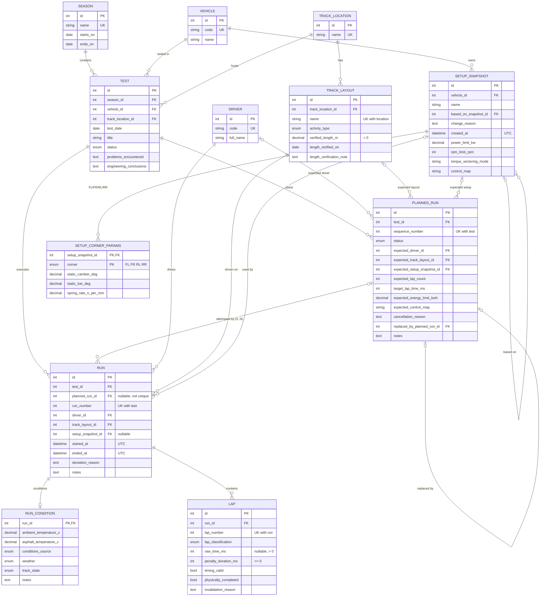

# Data Model

Status: **Phase 2 — MVP-Core schema implemented** (Alembic revision `0001`).
Source of truth: `backend/app/models/` and `backend/alembic/versions/0001_initial_schema.py`;
`backend/tests/test_migrations.py` verifies that the two produce the same schema.

Terminology: **run** always means an actual on-track run of the vehicle (table `run`),
never a software process execution. A **planned run** is the pre-test instruction.

## 1. Implemented schema (MVP-Core)

## 2. Engineering units and numeric precision

Units are carried in column names. Every physical quantity is metric/SI-derived.

| Column suffix | Unit | Storage | Precision |
|---|---|---|---|
| `_ms` | milliseconds | INTEGER | exact |
| `_m` (`verified_length_m`) | metres | NUMERIC(9,3) | 1 mm |
| `_c` | degrees Celsius | NUMERIC(4,1) | 0.1 °C |
| `_kw` | kilowatts | NUMERIC(6,2) | 0.01 kW |
| `_kwh` | kilowatt-hours | NUMERIC(6,3) | 1 Wh |
| `_rpm` | revolutions per minute | INTEGER | 1 rpm |
| `static_camber_deg` | degrees (negative = top inward) | NUMERIC(5,2) | 0.01° |
| `static_toe_deg` | degrees (negative = toe-out) | NUMERIC(5,3) | 0.001° |
| `_n_per_mm` | newtons per millimetre | NUMERIC(7,2) | 0.01 N/mm |
| `*_at` | UTC timestamp | DATETIME (naive UTC) | microseconds |
| `test_date`, `*_on` | local calendar date | DATE | day |

**SQLite limitation:** SQLite has no exact DECIMAL type. NUMERIC values are stored with
REAL/INTEGER affinity, and SQLAlchemy converts them back to `Decimal` at the declared scale.
At the precisions above, values round-trip deterministically (this is tested), and range
filters behave correctly. PostgreSQL stores them as exact `NUMERIC`.

**Timestamps:** `UTCDateTime` rejects naive datetimes, normalises aware values to UTC,
and returns values with `tzinfo=UTC`. Test days use `DATE`, because a test day is a
calendar concept, not an instant.

## 3. Relationship and modelling decisions

- **Test → TrackLocation; Run → TrackLayout.** This follows the brief ("track location" on
  the test). One test day may use several layouts at the same location, for example skidpad
  in the morning and autocross in the afternoon.
  *Rule:* a run's layout must belong to its test's location. This is a cross-row rule,
  **enforced in the service layer (Phase 4)**. Enforcing it in the database would need
  either a denormalised `track_location_id` on `run` plus a composite FK, which duplicates
  data, or a trigger. Phase 2 deliberately uses neither.
- **PlannedRun 1 → 0..N Run.** `run.planned_run_id` is nullable and **not unique**:
  - one plan can have several attempts (aborted attempt, retry);
  - an unexpected run has `planned_run_id = NULL`; no fake plan is created.

  Runs are numbered deterministically by `UNIQUE(test_id, run_number)`.
- **Planned values are never overwritten.** Actual values live on `run` and `lap`.
  Planned-versus-actual comparison is derived later by query (Phase 6). `expected_track_layout_id`
  was added to the planned run, so that the comparison can show a layout change.
- **Planned-run status transitions** are enforced in services (Phase 4). The database
  enforces only row-local invariants:
  - CANCELLED requires a reason;
  - REPLACED requires a replacement link, and vice versa;
  - a plan cannot replace itself.

  Same-test replacement is a cross-row rule, enforced in services.
- **Nothing derivable is stored.** The following are all computed in queries (Phase 5):
  - completed lap count;
  - effective lap time (`raw_time_ms + penalty_duration_ms`);
  - best lap;
  - mileage.
- **Setup snapshots are append-only.** A change creates a new snapshot with
  `based_on_snapshot_id`, `change_reason` (required by CHECK when derived) and `created_at`.
  One snapshot can be shared by many runs; that sharing is how reusable configurations are
  represented. No update operation will exist, which Phase 4 enforces and tests. No triggers are used.
- **Setup storage: typed columns, no EAV or JSON.**
  - Whole-vehicle parameters are typed columns on `setup_snapshot`.
  - Per-corner parameters are rows in `setup_corner_params`, with `PK(setup_snapshot_id, corner)`.

  A separate 1:1 `setup_vehicle_params` table (proposed in Phase 1) was **merged into
  `setup_snapshot`**. It would add a join, and a "snapshot without parameters" state,
  without adding any integrity. Torque-vectoring mode and control map are labels, not
  enums, because the available modes differ between vehicle generations.
- **Unknown values are NULL and never invented.** This covers:
  - `run.setup_snapshot_id` (setup unknown, e.g. imported history);
  - `lap.raw_time_ms` (lap driven but no time recorded);
  - all condition values.

  `run_condition.conditions_source` (MEASURED/ESTIMATED) is required whenever a temperature is present.
- **Delete behaviour:**
  - Owned children cascade: `lap` and `run_condition` with their run, and corner rows with
    their snapshot.
  - Every other FK uses the default (NO ACTION), so historical parents with children
    cannot be deleted. This is tested for `test`.

## 4. Lap semantics encoded in the schema

| Rule | Where |
|---|---|
| `lap_number > 0`, `UNIQUE(run_id, lap_number)` | DB |
| `raw_time_ms > 0` when present | DB |
| untimed lap (`raw_time_ms IS NULL`) ⇒ `timing_valid = false` | DB |
| `penalty_duration_ms >= 0`, default 0 | DB |
| `timing_valid` ⇔ `invalidation_reason` is NULL; invalid ⇒ non-blank reason | DB |
| classification ∈ {FLYING, IN_LAP, OUT_LAP, ABORTED} | DB |
| a penalised lap stays timing-valid | DB (no rule couples the two) |
| ABORTED vs physically completed | **service policy (Phase 5), not a DB rule** |
| plausibility (e.g. implied average speed limit per activity type) | **application policy (Phase 5)** |
| no global maximum lap time | deliberate |

Why ABORTED is not a database rule: "aborted" describes the timed attempt. A driver can
abort a push lap and still drive the complete loop back to the pits. Forcing
`physically_completed = false` would therefore lose real distance. The Phase 5 mileage policy
counts only `physically_completed` laps, and it will document how ABORTED laps are entered.

Temperature plausibility ranges are also application-level (Phase 5 validation). They are not
database CHECKs, because they are policy, not physical invariants.

## 5. Constraint naming

All constraints are named by the convention in `app/models/base.py`:
`pk_<table>`, `fk_<table>_<column>_<referred_table>`, `uq_<table>_<columns>`,
`ck_<table>_<name>`, `ix_<table>_<columns>`. This is required for SQLite batch
migrations, and it gives predictable names for IntegrityError translation (Phase 3).
SQLite reports CHECK failures by constraint name and UNIQUE failures by `table.column`.
FK failures carry no name, so services will pre-check referenced rows to return 404s.

## 6. Indexes

SQLite does not index foreign keys automatically. Each index is justified only by an
MVP-Core query. The data volume is small: tens of tests and thousands of laps per season.

| Index | Query supported | Column order / selectivity | Covered elsewhere? | Cost |
|---|---|---|---|---|
| `ix_test_season_id_test_date` | Tests of a season ordered by date; season filter in run search (`test.season_id = ? [AND test_date BETWEEN ? AND ?]`) | Equality first, then range/sort. Low selectivity for season alone, but it serves both filter and ordering. | No | One B-tree entry per test (low write rate) |
| `ix_test_vehicle_id_test_date` | Vehicle history; "previous run of this vehicle" for setup diffs (`vehicle_id = ? ORDER BY test_date`) | Same pattern | No | Same |
| `ix_run_driver_id` | Driver filter in run search; driver lifetime mileage | Medium selectivity (several drivers) | No | One entry per run |
| `ix_run_track_layout_id` | Layout filter; fastest laps per layout | Medium selectivity | No | One entry per run |

These patterns are already covered by unique constraints, so no extra index was added:

- `run.test_id`: prefix of `uq_run_test_id_run_number`.
- `lap.run_id`: prefix of `uq_lap_run_id_lap_number`.
- `planned_run.test_id`: prefix of `uq_planned_run_test_id_sequence_number`.
- `track_layout.track_location_id`: prefix of `uq_track_layout_track_location_id_name`.
- `setup_corner_params.setup_snapshot_id`: PK prefix.

Evaluated and **not** added:

| Candidate | Reason |
|---|---|
| `run(setup_snapshot_id)` | Its query (setup comparison) is MVP-Complete. Add it with that query. |
| `track_layout(activity_type)` | Tiny reference table; a scan is cheaper than an index lookup. |
| `run(planned_run_id)` | Plan-versus-actual reads all runs of one test, which `run.test_id` already covers. |
| `setup_snapshot(vehicle_id, …)` | Small table; reconsider when snapshot listing is implemented. |
| Temperature and effective-time expression indexes | Their queries don't exist yet. |

## 7. Deferred entities

None of these entities is needed as an anchor by the implemented tables. Each can be added later
in an additive Alembic revision (new tables with FKs to existing ones), with no destructive change.

| Entity | Class | Planned revision / phase | Attaches to |
|---|---|---|---|
| SeasonObjective, TestObjective, RunObjective | MVP-Complete | Phase 4 | season, test, run |
| TireCompound, TireSet, Tire, RunTireAssignment, TireMeasurement, AlignmentMeasurement | MVP-Complete | Phase 6 | run (assignment: `UNIQUE(run, corner)`, `UNIQUE(run, tire)`) |
| Wider setup parameters (dampers, ARB, corner mass, shims, ride height, aero) | MVP-Complete | Phase 4 | new nullable columns on existing setup tables |
| TelemetryFile (metadata index) | MVP-Complete | Phase 6 | test, optional run |
| ImportBatch (CSV import provenance) | MVP-Complete | Phase 7 | none |
| Station / Person / StationAssignment | Extended | after Phase 8 | test |
| LapSector | Extended | after Phase 8 | lap (`UNIQUE(lap, sector_number)`) |
| Setup parameter definitions/values | Extended | after Phase 8 | setup_snapshot |

## 8. Migrations

- Location: `backend/alembic/`. The URL comes from `DATABASE_URL` through `app.config`.
  Tests pass an explicit URL.
- `render_as_batch` is enabled for SQLite, because SQLite cannot ALTER constraints and
  batch mode recreates the table. The engine factory shared with the application sets
  `PRAGMA foreign_keys=ON`. Future batch migrations that recreate referenced tables must
  check for FK side effects.
- Migrations do not import application types, which keeps each revision frozen.
- The application never calls `create_all`. Only the drift test does, to build a comparison
  database.

### PostgreSQL migration notes

- NUMERIC becomes exact.
- Enum CHECKs work unchanged; native ENUM types are optional.
- `DATETIME` should become `timestamptz`, through a revision that changes `UTCDateTime`'s impl.
- The boolean CHECK expressions are already written portably (no `= 1`).
- FK errors name the constraint.
- Generated columns or expression indexes for effective time become an option.
- `render_as_batch` is not needed.
